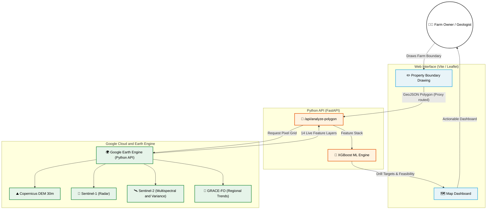

# Landsat Water Intelligence Platform
[]()
[]()
[]()
[]()
[]()

A research-grade groundwater siting support platform designed for hydrogeologists and farm owners in arid terrains (like the Kalahari and Okavango). It leverages real-time Google Earth Engine telemetry, Sentinel/Landsat satellite imagery, and an XGBoost machine learning model to rank groundwater prospectivity and support borehole siting decisions.

---

## 🚀 Live Application Architecture



| Component | Technology |
|---|---|
| **Frontend App** | Vite, Vanilla JS, Leaflet.js (Proxied) |
| **Map Tiles** | Microsoft Planetary Computer, Esri |
| **Backend API** | Python 3, FastAPI, Uvicorn |
| **Cloud Telemetry** | Google Earth Engine Python API |
| **Machine Learning** | XGBoost, Scikit-Learn |
| **Authentication** | GCP Service Accounts (.json keys) |
| **Styling** | Custom CSS (Field-Survey Palette) |

---

## 🛠️ Key Features
- **Interactive Farm Drawing:** Draw dynamic polygon boundaries directly on the map to bound the investigation.
- **Live Earth Engine Telemetry:** The Python backend queries Google Earth Engine dynamically, extracting live Topography (Slope, TWI), Structure (SAR VV/VH), and Vegetation indices (NDWI, NDVI).
- **Advanced Contextual Intelligence:** Automatically extracts and downscales 100km-resolution GRACE-FO Liquid Water Equivalent (LWE) trends and Sentinel-2 seasonal NDVI variance to identify persistent subsurface moisture versus transient rainfall.
- **XGBoost Prospectivity Scoring:** Processes satellite data through an XGBoost model trained on 84 labelled boreholes (Botswana) to produce a groundwater prospectivity score — the likelihood that a point is geologically similar to productive boreholes in the training set. **Does not output depth, yield, or clay fraction** (those require physical measurements).
- **Honest Data Limitations:** Training set is 84 boreholes across 6 locations; spatial cross-validation AUC is 0.71. The tool ranks candidate areas for field geophysical survey, not a guaranteed water location. See [Model Limitations](#️-model-limitations--honest-performance) below.
- **CORS-Resilient Architecture:** Utilizes a Vite development proxy to cleanly route frontend requests to the FastAPI backend, bypassing strict browser Cross-Origin Resource Sharing (CORS) blocks natively.
- **Automated Dossier Generation:** Prepares printable, professional hydrogeological reports instantly based on the drawn property boundaries.

---

---

## Warning: Model Limitations & Honest Performance

| Metric | Value | Notes |
|---|---|---|
| Training samples | 84 boreholes | 6 locations in Botswana |
| Class balance | 56 productive / 28 dry | Selection bias (drilled where water expected) |
| Spatial-CV AUC | 0.71 | GroupKFold by location |
| Overall accuracy | 0.62 | Region-held-out |
| Active features | 12 | SAR, spectral, terrain, NDVI variance |

**What the model scores:** Groundwater prospectivity -- likelihood that a point is
geologically similar to productive boreholes in the training set.

**What it does NOT output:** Depth to water table, aquifer yield, clay fraction, or
infiltration rate. These require physical measurements (VES/ERT geophysics, test borehole).

**Known limitations:**
- Structural geology (dyke/fault proximity) not yet included -- the biggest accuracy lever.
  Data request in progress with Botswana Geological Survey (llesole@gov.bw, BWA_DGS_1M_MLF/MSF).
- 84 boreholes from 6 locations is insufficient for reliable calibration. A DWS data request
  for hundreds of completion certificates is the highest-priority next step.
- BGI data may have date errors (0000-00-00, 1900) -- these rows must be excluded before retraining.
- Describe results as **siting support** for field geophysical survey, not guaranteed water locations.

**Improvement path:**
1. BWA_DGS_1M_MLF/MSF shapefiles (dykes + faults) -> add dist-to-dyke, lineament density -> expect +0.05-0.10 AUC
2. DWS borehole completion records (hundreds of labelled wells) -> biggest single accuracy lever
3. Test GLHYMPS permeability and Africa Groundwater Atlas aquifer layers
4. Target: spatial-CV AUC ~0.80, 80-85% precision in top-ranked sites

## 💻 Local Installation & Usage

### Prerequisites
1. Node.js (v18+)
2. Python (3.9+)
3. A Google Cloud Service Account JSON Key with Earth Engine Access

### 1. Setup the Frontend
```bash
npm install
npm run dev
```
*The frontend will launch on `http://localhost:5173`.*

### 2. Setup the Backend API
Install backend dependencies:
```bash
pip install -r backend/requirements.txt
```

Place your Google Cloud Service Account JSON key inside `.gee_secrets/service_account.json` (you will need to create this directory).

Start the FastAPI server:
```bash
python -m uvicorn backend.main:app --reload
```
*The API will listen on `http://127.0.0.1:8000`.*

---

## 📜 License
Proprietary / Closed Source. Developed for Landsat Water Intelligence operations.
